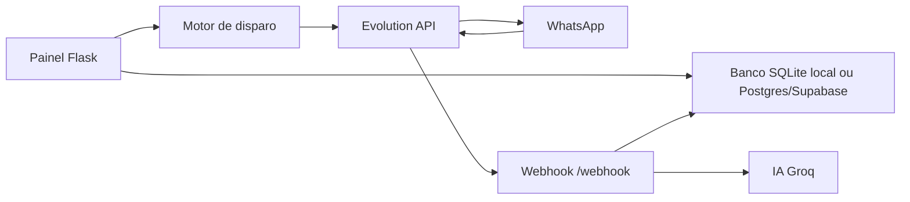

# ZAP Engine - WhatsApp Disparo e Atendimento IA

Sistema Python/Flask para importação de leads, disparo automático no WhatsApp via Evolution API e atendimento com IA em tom comercial humanizado para proteção veicular.

## O que o sistema faz

- Importa leads por CSV ou XLSX.
- Valida telefone brasileiro antes de salvar.
- Registra status: `pendente`, `enviado`, `respondeu`, `erro`, `ignorado`.
- Evita duplicidade pelo telefone.
- Evita reenvio rápido para o mesmo número usando cooldown.
- Envia com delays humanos variáveis, simulação de digitação e pausas longas por bloco.
- Respeita limite por hora e por dia.
- Permite pausar, retomar e parar campanha pelo painel.
- Responde leads via IA usando Groq, com respostas curtas e consultivas.
- Marca contato como `respondeu` quando chega mensagem pelo webhook.
- Consulta FIPE por placa como fluxo principal, com fallback manual seguro por seletores.
- Usa variáveis de ambiente para segredos.
- Roda localmente com SQLite e em nuvem com PostgreSQL/Supabase.

## Arquitetura



## Estrutura principal

```text
config/settings.py          Configuração via ambiente
database/                   Repositórios e schema SQLite/Postgres
services/disparo.py         Motor de campanha, delays e limites
services/evolution_api.py   Cliente da Evolution API
services/groq_ai.py         Atendimento IA e fluxo comercial
services/fipe_service.py    Consulta FIPE e montagem de proposta
panel/server.py             Painel Flask, APIs e webhook
panel/templates/index.html  Dashboard
```

## Instalação local

1. Crie o ambiente:

```bash
python -m venv venv
venv\Scripts\activate
pip install -r requirements.txt
```

2. Copie o exemplo de ambiente:

```bash
copy .env.example .env
```

3. Edite `.env`:

```env
EVOLUTION_API_URL=http://localhost:8080
EVOLUTION_API_KEY=sua-chave
AUTHENTICATION_API_KEY=sua-chave
INSTANCE_NAME=meu-whatsapp
GROQ_API_KEY=gsk_...
PANEL_USERNAME=admin
PANEL_PASSWORD=uma-senha-forte
WEBHOOK_SECRET=um-token-forte
```

4. Suba a Evolution API local:

```bash
docker compose up -d
```

5. Configure as variáveis de placa/FIPE no `.env`:

```env
PLACA_FIPE_PROVIDER=buscafipe
PLACA_FIPE_API_URL=https://buscafipe.com/api
PLACA_FIPE_API_KEY=
FIPE_PROVIDER=parallelum
FIPE_API_URL=https://parallelum.com.br/fipe/api/v1
```

6. Crie/conecte a instância:

```bash
python setup_instancia.py
```

7. Rode o painel:

```bash
python -m panel.server
```

Acesse `http://localhost:5000`.

## Formato da planilha

Campos aceitos:

```csv
nome,telefone,cidade,status,observacoes
João Silva,31999999999,Barbacena,pendente,Lead de campanha maio
Maria Souza,31988888888,São João del Rei,pendente,Tem seguro atualmente
```

Obrigatório: `telefone`.

Também são aceitos cabeçalhos equivalentes como `celular`, `whatsapp`, `município`, `obs` e `observação`.

## Delays humanos e anti-ban

Configuração recomendada para chip aquecido:

- Delay mínimo entre mensagens: `18s`
- Delay máximo entre mensagens: `90s`
- Pausa longa a cada `10` contatos
- Pausa longa: `7` a `30` minutos
- Limite por hora: `18`
- Limite por dia: `80`
- Cooldown de reenvio: `72h`

Para chip novo, use o modo aquecimento no painel. O sistema reduz o limite diário conforme o dia de aquecimento.

## IA humanizada

Use `GROQ_API_KEY` no `.env` ou configure pelo painel.

A IA trabalha com estes estágios:

- lead frio
- lead interessado
- lead que já possui seguro/proteção
- lead sem interesse
- lead que pediu valor
- lead que informou veículo
- lead parado

As respostas são curtas, em português brasileiro, com próximo passo claro: pedir placa, consultar FIPE, preparar proposta ou chamar consultor.

No fluxo de cotação, o painel agora prioriza a placa do veículo. Se a placa não estiver disponível, use o fallback manual seguro com marca, modelo e ano selecionados em listas controladas.

### Provider de placa recomendado

- `BuscaFIPE`: opção mais simples para teste/hobby e com documentação pública.
- `API Placas`: opção alternativa com retorno mais rico, normalmente usada com token.

Os dois providers são configuráveis por ambiente. O painel não expõe chave no frontend.

## Webhook da Evolution API

No painel, abra `IA & Chatbot` e clique em `Configurar webhook automaticamente`.

Em nuvem, a URL deve ficar assim:

```text
https://seu-app.onrender.com/webhook?token=SEU_WEBHOOK_SECRET
```

Eventos necessários:

```text
MESSAGES_UPSERT
```

Se o WhatsApp cair:

1. Verifique `/api/whatsapp-status`.
2. Abra a Evolution API.
3. Gere novo QR Code.
4. Escaneie novamente no WhatsApp.
5. Retome a campanha pelo painel.

## Deploy em nuvem com custo zero ou baixo

### Escolha recomendada

Para custo zero de teste/hobby:

- Render Free para o painel Flask.
- Supabase Free para PostgreSQL.
- Evolution API apontada por `EVOLUTION_API_URL`.

Limitação importante: serviços grátis que dormem podem derrubar a conexão do WhatsApp Web/Evolution. Para operação comercial estável, o componente mais crítico é a Evolution API, que idealmente deve ficar em um serviço always-on.

### Por que não GitHub Actions?

GitHub Actions é bom para jobs agendados e CI, mas não é adequado para manter WhatsApp conectado 24/7 nem para receber webhooks continuamente.

### Limitações conhecidas dos planos grátis

- Render Free: web services podem dormir após período sem tráfego inbound.
- Supabase Free: banco gratuito tem limite de tamanho e projetos.
- Fly.io: atualmente não é uma opção de free tier contínuo para produção nova.
- Replit/Railway: planos gratuitos mudam bastante e podem exigir créditos ou hibernação.
- Consulta por placa depende do provider configurado. O `BuscaFIPE` é uma opção simples para teste/hobby; o `API Placas` exige token e costuma retornar dados mais completos.

Links úteis:

- Render Free: https://render.com/docs/free
- Supabase Billing/Free: https://supabase.com/docs/guides/platform/billing-on-supabase
- GitHub Actions Billing: https://docs.github.com/en/actions/administering-github-actions/usage-limits-billing-and-administration
- Fly.io Free Trial: https://fly.io/docs/about/free-trial/

## Deploy no Render + Supabase

1. Crie um projeto no Supabase.
2. Copie a connection string PostgreSQL.
3. No Render, crie um `Web Service` apontando para este repositório.
4. Build command:

```bash
pip install -r requirements.txt
```

5. Start command:

```bash
gunicorn panel.server:app --bind 0.0.0.0:$PORT --workers 1 --threads 4 --timeout 120
```

6. Configure variáveis:

```env
PORT=10000
DATABASE_URL=postgresql://...
PUBLIC_BASE_URL=https://seu-app.onrender.com
PANEL_USERNAME=admin
PANEL_PASSWORD=senha-forte
WEBHOOK_SECRET=token-forte
EVOLUTION_API_URL=https://sua-evolution-api
EVOLUTION_API_KEY=sua-chave
INSTANCE_NAME=meu-whatsapp
GROQ_API_KEY=gsk_...
```

7. Abra o painel, configure o webhook e teste uma mensagem.

## Segurança

- Nunca commite `.env`.
- Use senha no painel em nuvem (`PANEL_USERNAME` e `PANEL_PASSWORD`).
- Use `WEBHOOK_SECRET`.
- Prefira `GROQ_API_KEY` por variável de ambiente.
- O endpoint `/api/health` fica aberto para health check.
- O webhook não usa autenticação básica, mas valida o token quando configurado.

## Observação sobre WhatsApp

Evite disparos agressivos, listas frias sem origem clara e mensagens repetidas. O sistema ajuda com ritmo humano, mas não elimina riscos de bloqueio da conta. Use consentimento, mensagens curtas e volume gradual.

## Railway

O Railway pode ser usado como alternativa de baixo custo quando a conta tiver free credits disponiveis. O fluxo continua o mesmo para o painel Flask:

1. Crie o projeto.
2. Suba este repositório.
3. Configure `DATABASE_URL`, `PUBLIC_BASE_URL`, `PANEL_USERNAME`, `PANEL_PASSWORD`, `WEBHOOK_SECRET`, `EVOLUTION_API_URL`, `EVOLUTION_API_KEY`, `INSTANCE_NAME` e `GROQ_API_KEY`.
4. Use `gunicorn panel.server:app --bind 0.0.0.0:$PORT --workers 1 --threads 4 --timeout 120` como start command.

Na prática, Render + Supabase costuma ser a combinação mais previsível para o painel, enquanto Railway fica como opção secundária quando houver free credits ativos.

## Executável Windows

Para gerar o `.exe`:

```bash
gerar_exe.bat
```

O pacote final fica em `dist\ZAP_ENGINE.exe` e abre o painel automaticamente ao iniciar. O arquivo `iniciar_sistema.bat` também inicia o executável quando ele já tiver sido gerado.

Mantenha o arquivo `.env` na mesma pasta do executável para que as configurações sejam carregadas no Windows.

Se você precisar compilar manualmente, o comando equivalente é:

```bash
python -m PyInstaller --clean --noconfirm build.spec
```
